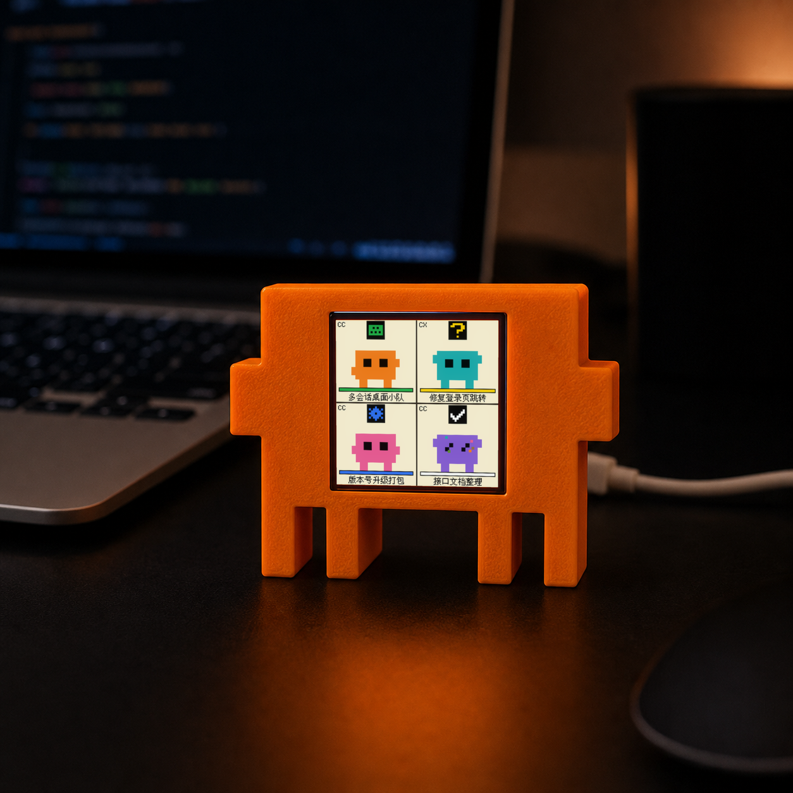
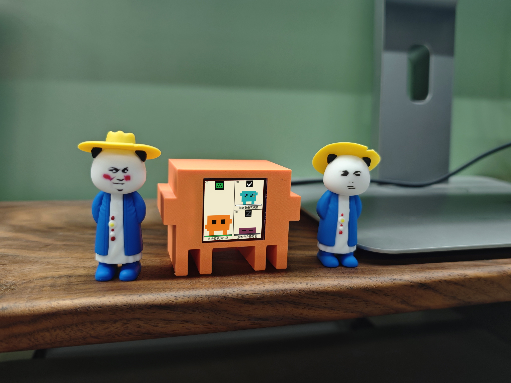
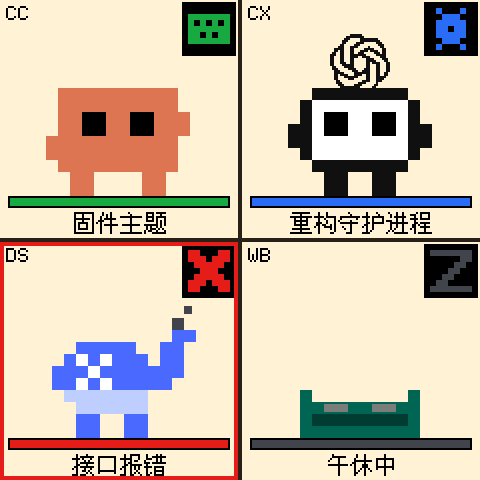
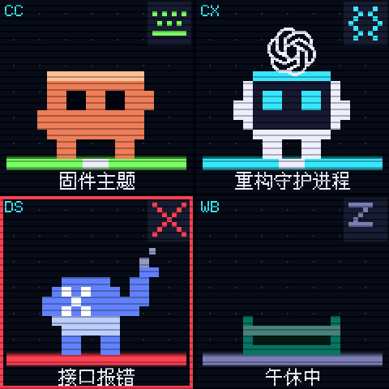
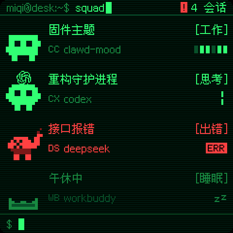
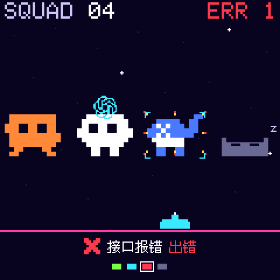
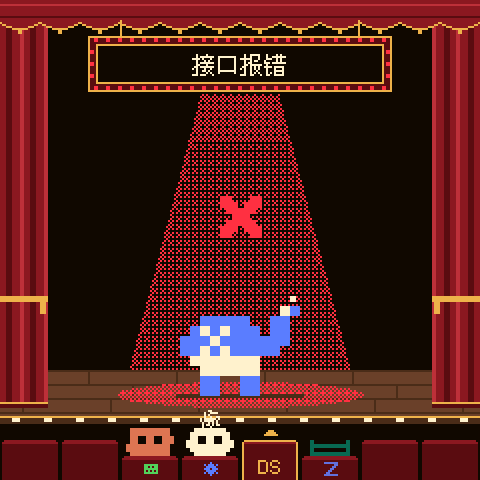
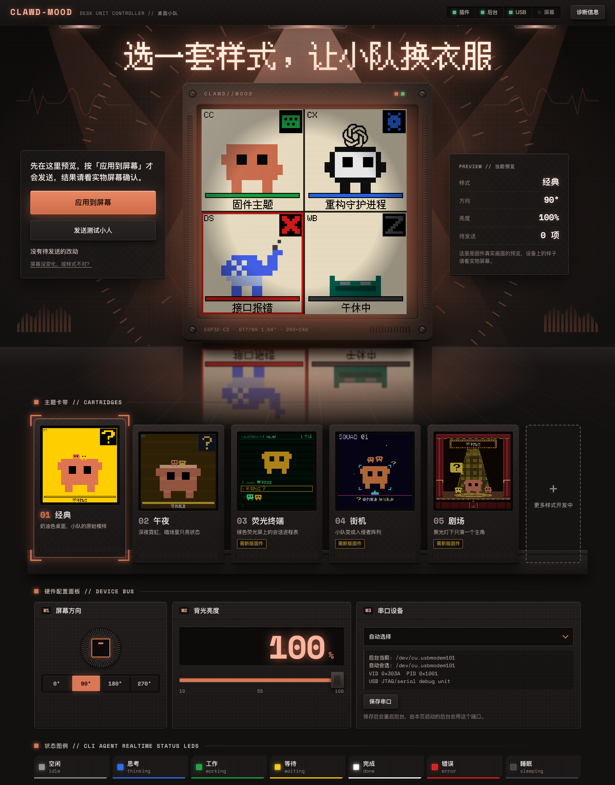

# clawd-mood

ESP32-C3 + ST7789 1.54" TFT 桌面摆件，实时显示 **Claude Code** / **Codex CLI** / **OpenCode** / **pi** / **WorkBuddy** / **DeepSeek Harness** / **Cursor** 的运行状态。每个会话是一只像素小生物，显示会话标题和当前状态；多个 agent 可以同时用。支持 macOS / Linux / Windows。

<p align="center">
  
  
</p>

## 屏幕样式

<table>
  <tr>
    <td align="center" width="33%"><br /><b>01 经典</b>（默认）</td>
    <td align="center" width="33%"><br /><b>02 午夜</b></td>
    <td align="center" width="33%"><br /><b>03 荧光终端</b></td>
  </tr>
  <tr>
    <td align="center"><br /><b>04 街机</b></td>
    <td align="center"><br /><b>05 剧场</b></td>
  </tr>
</table>

## 安装

需要一块 ESP32-C3 和一块 ST7789 1.54" 240×240 SPI 屏，按下表接线后用数据线插到电脑上。

### 接线（VCC 接 3.3V，**不要接 5V**）

| Display | ESP32-C3 |
| ------- | -------- |
| VCC     | 3V3      |
| GND     | GND      |
| SDA     | GPIO 10  |
| SCL     | GPIO 8   |
| RES     | GPIO 2   |
| DC      | GPIO 1   |
| CS      | GPIO 4   |
| BL      | GPIO 3   |

### 让 agent 安装

先装上 clawd-mood 技能（需要 Node.js ≥ 22.20，会问你装给哪些 agent）：

```bash
npx skills add liuyingwen/clawd-desktop-buddy -g
```

再跟 agent 说「帮我安装 clawd-mood」。它会装好工具链、烧录固件、接上插件，最后在屏幕上放一个测试小人让你确认。之后换样式、排查、更新、卸载也都直接跟它说。

不想装技能，就把这段话发给 agent：

```text
请帮我安装 clawd-mood：https://github.com/liuyingwen/clawd-desktop-buddy
克隆到 ~/clawd-mood，按 .agents/skills/clawd-mood/SKILL.md 的步骤安装，只接你自己这个 CLI。
需要我动手的步骤告诉我；需要 sudo 或修改系统配置时先问我。
```

不用 agent 的话，照着 [SKILL.md](.agents/skills/clawd-mood/SKILL.md) 手动做也一样。

## 换样式

跟 agent 说「把 clawd-mood 换成午夜主题」「屏幕亮度调到 60」「屏幕倒过来了」就行。也可以打开配置页，看着预览自己挑：

```bash
uv run page/serve.py
```



主题 3–5 需要较新的固件，选了没反应就让 agent 重烧一次。

## 屏幕上显示什么

| 状态 | 经典主题里 | 什么时候 |
| --- | --- | --- |
| Idle | 灰 | 空闲 |
| Thinking | 蓝，齿轮 | 你发了消息，模型在想 |
| Working | 绿，键盘 | 调用工具 |
| Waiting | 黄，问号，闪烁 | 等你批准或回答（Cursor 没有） |
| Done | 白，对勾 | 回答完成，3 秒后回到 Idle |
| Error | 红，叉号 | 回合出错，比如 API 报错 |
| Sleeping | 深灰，Z | 5 分钟没动静 |

每个工具一个由 logo 拟人的小人，子代理是它头顶的小跟班。会话多了自动翻页，有会话等你批准或出错时会先翻到它。

屏幕没反应、想更新或卸载，也直接跟 agent 说。

## 已知限制

- Windows 和 Linux 还没在真机上完整跑过，试过的话欢迎开 issue。
- 主题、方向和亮度设置还没在真机上确认过，主题 3–5 只在预览里看过。

## 许可证

[Apache License 2.0](LICENSE)。Copyright 2026 刘英文。归属说明见 [NOTICE](NOTICE)。
