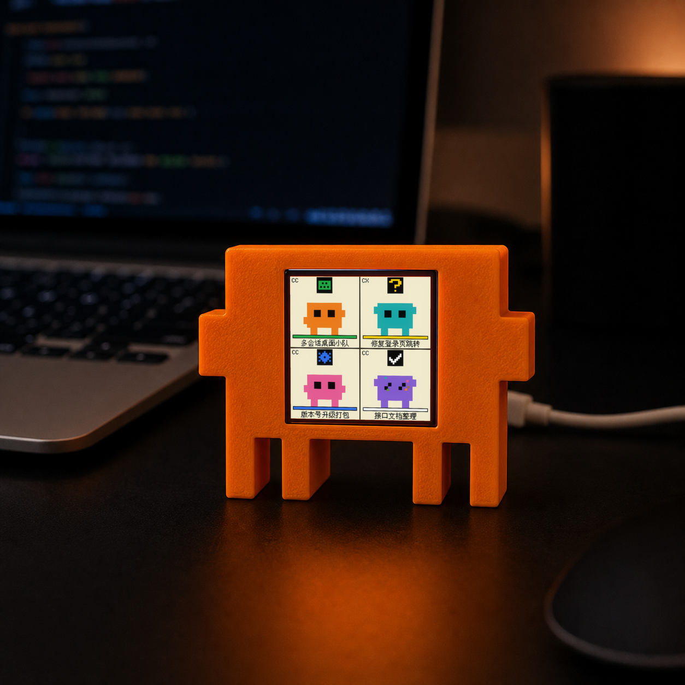
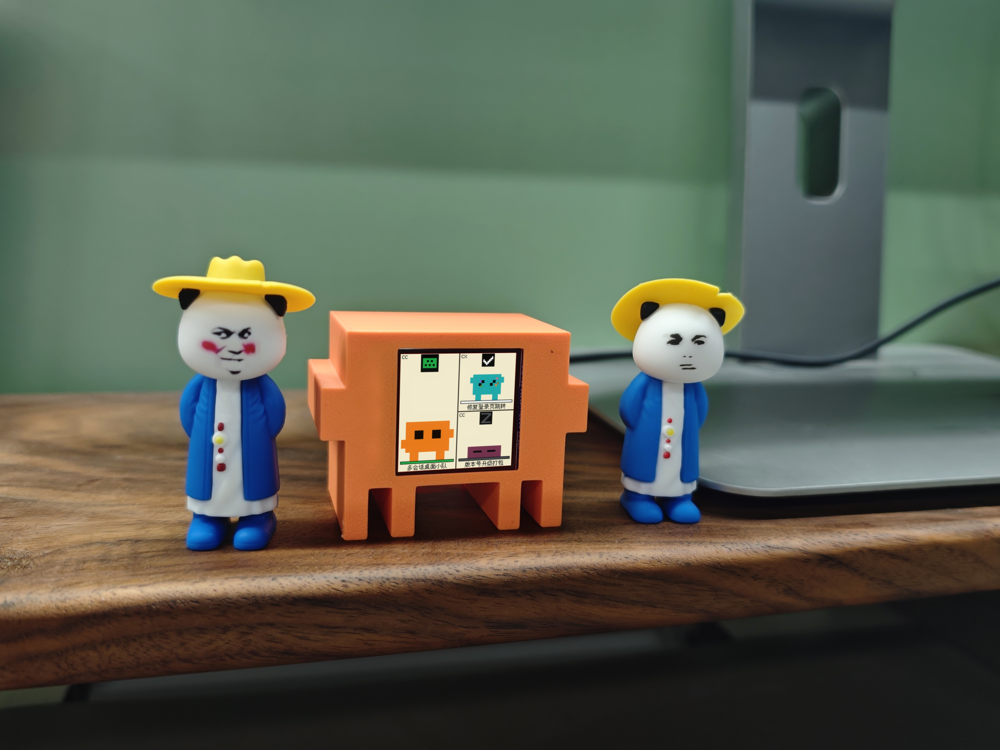

# clawd-mood

ESP32-C3 + ST7789 1.54" TFT 桌面摆件，USB 串口实时显示 **Claude Code** / **OpenAI Codex CLI** / **OpenCode** / **pi** / **WorkBuddy（CodeBuddy Code）** / **DeepSeek Harness** 的运行状态。每个会话是一只像素小生物，同时显示会话标题和 7 种状态之一（idle / thinking / working / waiting / done / error / sleeping）。各端可独立挂、可同装、可同时跑。跨平台：macOS / Linux / Windows。

以 [Apache License 2.0](LICENSE) 开源。

**把下面这段话发给你的 agent，它会照着完成安装**（硬件要先按[接线表](#3-接线vcc-接-33v不要接-5v)接好并插上 USB）：

```text
请帮我安装 clawd-mood：https://github.com/liuyingwen/clawd-desktop-buddy
1. 克隆仓库，阅读 README.md，按其中的步骤操作。
2. 安装依赖和固件所需的板支持、库，找到 ESP32-C3 的串口，编译并烧录固件。
3. 判断你自己是哪个 CLI，只挂载对应的插件；有需要我手动完成的步骤（比如 Codex 的 /hooks 信任、重启应用）就告诉我。
4. 启动 daemon，灌一条 {"state":"working"} 测试消息，然后问我屏幕有没有变化。
需要 sudo 或修改系统配置时，先征求我的同意。
```

<p align="center">
  
  
</p>

## 准备

### macOS

```bash
brew install arduino-cli uv
```

### Linux

```bash
# Debian/Ubuntu
sudo apt install arduino-cli
curl -LsSf https://astral.sh/uv/install.sh | sh

# Arch
sudo pacman -S arduino-cli
curl -LsSf https://astral.sh/uv/install.sh | sh

# 串口权限：把用户加进 dialout 组后重新登录
sudo usermod -aG dialout $USER
```

### Windows

> ⚠️ **Untested on Windows.** 代码路径已 review 但未在真实 Windows + ESP32 硬件上端到端验证。试过的话请开 issue 反馈结果。

```powershell
winget install ArduinoSA.CLI
winget install astral-sh.uv
```

## 烧固件

### 1. 装 ESP32 板支持

```bash
arduino-cli config init --overwrite
arduino-cli config add board_manager.additional_urls https://raw.githubusercontent.com/espressif/arduino-esp32/gh-pages/package_esp32_index.json
arduino-cli core update-index
arduino-cli core install esp32:esp32
```

### 2. 装 Arduino 库

```bash
arduino-cli lib install "Adafruit GFX Library" "Adafruit ST7735 and ST7789 Library" "ArduinoJson" "U8g2_for_Adafruit_GFX"
```

### 3. 接线（VCC 接 3.3V，**不要接 5V**）

| Display | ESP32-C3 |
| ------- | -------- |
| VCC     | 3V3      |
| GND     | GND      |
| SDA     | GPIO 10  |
| SCL     | GPIO 8   |
| RES     | GPIO 2   |
| DC      | GPIO 1   |
| CS      | GPIO 4   |
| BL      | GPIO 3   |

### 4. 查 ESP32 端口

- macOS: `ls /dev/cu.usbmodem*`
- Linux: `ls /dev/ttyACM* /dev/ttyUSB* 2>/dev/null`
- Windows PowerShell: `Get-CimInstance Win32_SerialPort | Select Name,DeviceID`

### 5. 编译 + 上传

编译（三平台相同）：

```bash
arduino-cli compile -b esp32:esp32:esp32c3:CDCOnBoot=cdc,CPUFreq=160,UploadSpeed=921600 firmware/clawd_mood
```

上传时把 `-p` 后面的端口名换成实际的：

| 平台 | 示例端口 |
|---|---|
| macOS | `/dev/cu.usbmodem101` |
| Linux | `/dev/ttyACM0` |
| Windows | `COM3` |

```bash
arduino-cli upload -p <PORT> -b esp32:esp32:esp32c3:CDCOnBoot=cdc,CPUFreq=160,UploadSpeed=921600 firmware/clawd_mood
```

## 使用

### 1. 启动 daemon

```bash
# mac/linux
./plugin/scripts/daemon.py

# Windows PowerShell
uv run plugin\scripts\daemon.py
```

首次启动 uv 会自动装 pyserial。看到下面就绪：

```
clawd-mood daemon started
  TCP:    127.0.0.1:48756
  Portfile: /var/folders/.../T/clawd-mood.port
  Serial: /dev/cu.usbmodem101
  Ready!
```

让它一直挂着。

### 2. 挂载到 CLI

两端可独立挂、可同装。

#### Claude Code

推荐：**marketplace install**（一次注册，全局生效，写入 `~/.claude/settings.json` 的 `enabledPlugins`）：

```bash
cd /path/to/clawd-mood
claude plugin marketplace add ./
claude plugin install clawd-mood@clawd-mood
```

之后任意目录跑 `claude` 都自动挂上，无需 `--plugin-dir`。`/hooks` 确认 12 个事件全挂上。卸载：

```bash
claude plugin uninstall clawd-mood@clawd-mood
claude plugin marketplace remove clawd-mood
```

临时/开发用 `--plugin-dir`（不写 settings.json，只对当前会话生效）：

```bash
claude --plugin-dir /path/to/clawd-mood/plugin
```

#### Codex CLI（≥ 0.133.0）

首次：

```bash
cd /path/to/clawd-mood
codex plugin marketplace add .
codex plugin add clawd-mood@clawd-mood
```

**Codex 默认不执行未信任的 hook**：装完后在 codex 里运行 `/hooks`，审阅并信任 clawd-mood 的 10 个事件，否则屏幕不会有反应。信任绑定 hook 内容的哈希，hook 变更后需要重新信任。

之后任意目录 `codex` 即可。

卸载：

```bash
codex plugin remove clawd-mood@clawd-mood
codex plugin marketplace remove clawd-mood
```

> Codex 是把 plugin **拷贝**到 `~/.codex/plugins/cache/`，改了 `plugin/scripts/hook.py` 等源文件后需要 `codex plugin remove/add` 才生效。Claude Code 的 `--plugin-dir` 是 live path，无此问题。

#### OpenCode（≥ 2.0）

把插件软链到全局插件目录，然后重载：

```bash
mkdir -p ~/.config/opencode/plugins
ln -s /path/to/clawd-mood/plugin/adapters/opencode/clawd-mood.js ~/.config/opencode/plugins/clawd-mood.js
opencode reload
```

必须用软链（或插件能解析回仓库的方式），插件靠真实路径定位 `scripts/hook.py`。V1 插件接口在 OpenCode 2 不生效，所以不支持 1.x。卸载：删掉这个软链。

#### pi

```bash
pi install /path/to/clawd-mood/plugin/adapters/pi/clawd-mood.ts
```

卸载：`pi remove /path/to/clawd-mood/plugin/adapters/pi/clawd-mood.ts`。

#### WorkBuddy / CodeBuddy Code

```bash
cd /path/to/clawd-mood
codebuddy plugin marketplace add .
codebuddy plugin install clawd-mood@clawd-mood
```

WorkBuddy 桌面版使用自己的配置目录，命令前加 `CODEBUDDY_CONFIG_DIR=~/.workbuddy`，再重启应用。`codebuddy` 可执行文件在 `/Applications/WorkBuddy.app/Contents/Resources/app.asar.unpacked/cli/bin/codebuddy`。桌面版尚未端到端验证；从访达启动时 `PATH` 里可能没有 `uv`，屏幕没反应时先查这里。

#### DeepSeek Harness

通过官方的 Claude Code hook 桥接。先在要用的 profile 里装桥接包（版本与 `dsh --version` 一致）：

```bash
dsh plugin --profile web add @deepseek-ai/dsh-hooks-claude-code@<版本> @deepseek-ai/dsh-hook-protocol@<版本>
```

然后在 `~/.dsh/profiles/web/cordis.patch.yml` 末尾加一段（**两个路径都必须是绝对路径**），并重启 dsh：

```yaml
- insert:
    - id: clawd-mood-hooks
      name: '@deepseek-ai/dsh-hooks-claude-code'
      config:
        configPath: /path/to/clawd-mood/plugin/hooks/hooks-dsh.json
        pluginRoot: /path/to/clawd-mood/plugin
```

限制：桥接只支持 5 个事件，所以**不显示 waiting 和 error**，也没有压缩状态。hook 跑在 dsh 沙箱里，`uv` 无法运行，因此改用系统 `python3`，且**无法自动拉起 daemon**——请手动启动，或先让其他 agent 拉起。桌面版的 profile 名是 `desktop`。

#### 同时挂

多端可同时跑，每个会话各占一格，左上角标来源：`CC`（Claude Code）、`CX`（Codex）、`OC`（OpenCode）、`PI`（pi）、`WB`（WorkBuddy / CodeBuddy Code）、`DS`（DeepSeek Harness）。daemon 单实例、TCP server 多客户端，互不冲突。OpenCode 和 pi 按进程计，一个进程一只。

### 3. 屏幕说明

每页最多显示 4 个会话并撑满屏幕：1 个全屏，2 个左右拆分，3 个左大右二，4 个 2×2。超过 4 个时每 5 秒自动翻页；别的页有会话进入 Waiting 或 Error 时会立即翻过去，停留到状态解除，最多 10 秒；单次工具失败只显示 Error，不翻页，因为 agent 通常会继续干活。

每格下方显示会话标题，还没有标题时显示目录名。标题读自 CLI 的内部数据（目前支持 Claude Code 和 Codex），读不到时同样显示目录名。中文支持 GB2312 字符集，范围外的字符和 emoji 不显示。

| 状态     | 地砖色 / 图标 | 触发                                                                  |
| -------- | ------------- | --------------------------------------------------------------------- |
| Idle     | 灰 / 无 | 会话开始或结束 / Stop 后 3 秒回归 / 中断回合（Codex、OpenCode、pi）   |
| Thinking | 蓝 / 齿轮 | 提交 prompt / 压缩上下文中                                            |
| Working  | 绿 / 键盘 | 调用工具 / 压缩完恢复                                                 |
| Waiting  | 黄 / 问号，格子闪烁 | 等你批准或回答问题（DeepSeek Harness 无）                             |
| Done     | 白 / 对勾 | 回答完成（3 秒瞬态）                                                  |
| Error    | 红 / 叉号，红框 | 工具失败 / API 报错（Claude、WorkBuddy、OpenCode、pi）                 |
| Sleeping | 深灰 / Z | 5 分钟无事件（Working 为 15 分钟，Waiting 不睡）；30 分钟无事件的会话会从屏幕移除 |

各端能显示的状态：

| 端               | 接入方式                  | waiting | error | 压缩 | 自动拉起 daemon |
| ---------------- | ------------------------- | ------- | ----- | ---- | --------------- |
| Claude Code      | 插件 hooks                | ✓       | ✓     | ✓    | ✓               |
| Codex CLI        | 插件 hooks                | ✓       | —     | ✓    | ✓               |
| OpenCode ≥ 2.0   | 进程内插件                | ✓       | ✓     | ✓    | ✓               |
| pi               | 进程内扩展                | 仅扩展弹窗 | ✓  | ✓    | ✓               |
| WorkBuddy        | 插件 hooks（同 Claude）   | ✓       | ✓     | ✓    | ✓               |
| DeepSeek Harness | 官方 Claude Code hook 桥接 | —      | —     | —    | —               |

### 4. 快速验证

挂载完，跑一个任意短任务（Claude Code 或 Codex 都行），观察屏幕上该会话的状态序列：

```
Idle → Thinking → Working → Done → Idle（Done 3 秒后自动回 Idle）
```

Codex 特有事件验证：

| 触发动作                  | 期望状态     | 对应事件             |
| ------------------------- | ------------ | -------------------- |
| codex 弹出命令批准提示    | Waiting      | `PermissionRequest`  |
| codex `/compact` 压缩中   | Thinking     | `PreCompact`         |
| codex 压缩完成            | Working      | `PostCompact`        |

不依赖 CLI 直接灌一个 state 看屏幕：

```bash
# mac/linux
printf '{"state":"working"}\n' | nc 127.0.0.1 $(cat ${TMPDIR:-/tmp}/clawd-mood.port)
```

```powershell
# Windows PowerShell（untested）
$p = Get-Content $env:TEMP\clawd-mood.port
$c = New-Object Net.Sockets.TcpClient('127.0.0.1', $p)
$s = $c.GetStream()
$b = [Text.Encoding]::UTF8.GetBytes('{"state":"working"}' + "`n")
$s.Write($b, 0, $b.Length); $c.Close()
```

屏幕没动？看 daemon log：

```bash
# mac/linux
tail -f ${TMPDIR:-/tmp}/clawd-mood-daemon.log

# Windows PowerShell
Get-Content $env:TEMP\clawd-mood-daemon.log -Wait
```

每次事件应新增一行 `-> {"state":"...","event":"...","tool":"...","session":"...","name":"...","src":"CC"}`，有标题时还带 `title`。

---

## 卸载

```bash
# Claude Code
claude plugin uninstall clawd-mood@clawd-mood
claude plugin marketplace remove clawd-mood

# Codex
codex plugin remove clawd-mood@clawd-mood
codex plugin marketplace remove clawd-mood

# OpenCode
rm ~/.config/opencode/plugins/clawd-mood.js

# pi
pi remove /path/to/clawd-mood/plugin/adapters/pi/clawd-mood.ts

# WorkBuddy / CodeBuddy Code
codebuddy plugin uninstall clawd-mood@clawd-mood
codebuddy plugin marketplace remove clawd-mood

# DeepSeek Harness：从 cordis.patch.yml 删掉 clawd-mood-hooks 这段（别把文件删空，空 patch 会导致启动失败）
```

停 daemon + 清理：

```bash
# mac/linux
pkill -f scripts/daemon.py; rm -f ${TMPDIR:-/tmp}/clawd-mood.port
```

```powershell
# Windows PowerShell
Get-Process python | Where-Object { $_.CommandLine -like '*daemon.py*' } | Stop-Process
Remove-Item $env:TEMP\clawd-mood.port -ErrorAction SilentlyContinue
```

---

## 故障排除

- **屏幕不亮**：检查接线，特别是 VCC 是不是接到 3V3 而不是 5V
- **屏幕方向不对**：改 `firmware/clawd_mood/clawd_mood.ino` 里 `tft.setRotation(1)` 换成 0/2/3 重烧
- **`No ESP32-like USB CDC device found`**：板子没插好，或者 USB 数据线只能充电不能传输；Linux 检查是否加入 `dialout` 组；Windows 检查设备管理器有无未识别设备
- **多个 ESP32 同时插**：用环境变量指定端口
  - mac/linux: `CLAWD_MOOD_PORT=/dev/cu.usbmodemXXX ./plugin/scripts/daemon.py`
  - Windows PowerShell: `$env:CLAWD_MOOD_PORT='COM7'; uv run plugin\scripts\daemon.py`
- **默认 TCP 端口 48756 被占**：daemon 会自动回退到 OS 分配的空闲端口（写进 portfile），hook 读 portfile 自动跟随。要强制指定：`CLAWD_MOOD_PORT_TCP=49000 ./plugin/scripts/daemon.py`（显式指定时冲突会直接报错退出）
- **Codex 不识别插件**：检查 `codex plugin marketplace list` 看本地 marketplace 是否注册；若 marketplace 路径变了，先 `codex plugin marketplace remove clawd-mood` 再 `add` 一次
- **Codex 改完 hook.py 没生效**：codex 是拷贝缓存，要 `codex plugin remove clawd-mood@clawd-mood && codex plugin add clawd-mood@clawd-mood` 刷新
- **Codex 里屏幕完全没反应**：hook 还没被信任，在 codex 里运行 `/hooks` 审阅并信任
- **OpenCode 屏幕没反应**：确认版本 ≥ 2.0、软链有效，运行 `opencode reload` 或重启后台服务让插件重新加载
- **DeepSeek Harness 屏幕没反应**：daemon 不会被它拉起，先手动启动；再确认 profile 里装了桥接包、`configPath` 是绝对路径（路径错误时桥接只打警告，不注册 hook）

## 许可证

[Apache License 2.0](LICENSE)。Copyright 2026 刘英文。归属说明见 [NOTICE](NOTICE)。
